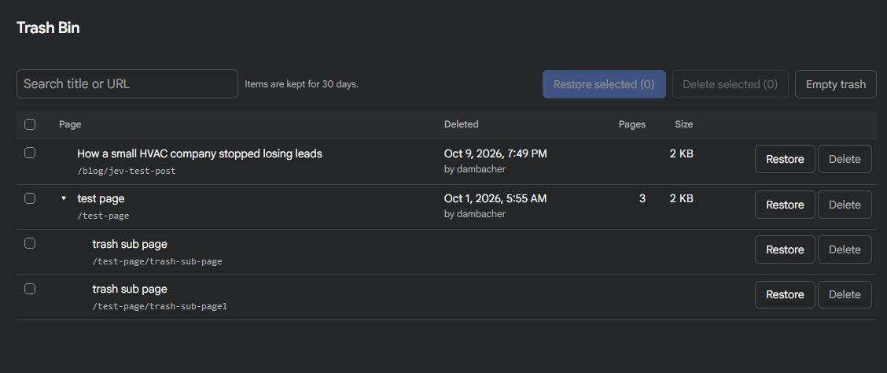

# Trash Bin

Deleted pages go to a trash instead of disappearing. Restore them from the **Trash** entry in the Admin 2 sidebar: children, media, translations, folder names and order prefixes included, so URLs come back as they were.



Requires Grav 2.0+ with the `api` and `admin2` plugins.

## Installation

Not in GPM yet. Download the [latest release](https://github.com/d-damba/grav-plugin-trash-bin/releases), unzip it into `user/plugins/trash-bin`, and clear the cache. Or:

```
cd user/plugins
git clone https://github.com/d-damba/grav-plugin-trash-bin.git trash-bin
```

## How it works

Every page delete made through the API (Admin 2 single delete, batch delete, deleting one translation) is copied to `user/data/trash/` first, then Grav deletes the page as usual. The plugin never blocks or changes a delete.

**If the copy fails, the delete goes ahead and the failure goes to the Grav log.** The Trash page also shows a banner for it until dismissed.

## The Trash page

- An expandable tree, like the pages list: title, URL, when and by whom, number of pages, size.
- Search by title or URL, child pages included.
- Restore, or delete permanently, any page in the tree or the selected ones. Ticking a page ticks everything under it; untick a child to leave it in the trash. Empty the trash.
- A folder whose page is back but whose children are still in the trash shows as "not in trash", so the children keep their place and can go back under it later.
- The sidebar count is every page in the trash, children included.
- If the URL is taken again, or the parent page is gone, restore asks for another location. If the parent is also in the trash, it offers to restore that too.
- Items are removed for good after `retention_days` (default 30; `0` keeps them until you empty the trash).

## Permissions

- `api.trash.read`: see the trash.
- `api.trash.write`: restore, delete permanently, empty. Restoring also needs `api.pages.write`.

## API

| Method | Endpoint | |
| --- | --- | --- |
| `GET` | `/trash` | Entries (each page entry with its `tree`), last copy failure, retention |
| `GET` | `/trash/badge` | `{ count }` of pages for the sidebar |
| `POST` | `/trash/{id}/restore` | Optional body `{ "node": "01.post", "exclude": ["01.post/01.sub"], "parent": "/route", "folder": "01.name" }`. `node` is a folder path below the entry's top folder (`""`, the default, is the top one); `exclude` stays in the trash; `parent`/`folder` restore elsewhere. `409` with `code` `location_taken`, `parent_missing` or `parent_in_trash` |
| `POST` | `/trash/{id}/discard` | Body `{ "node": "…", "exclude": […] }`: delete one page of an entry permanently |
| `DELETE` | `/trash/{id}` | Delete one entry permanently |
| `DELETE` | `/trash` | Empty the trash |
| `DELETE` | `/trash/failure` | Dismiss the copy-failure banner |

## For plugin developers

`onTrashPageRestored` fires after a restore with `entry`, `node`, `route` and `path` (relative to `user/pages`). Plugins that keep per-page data outside the page folder can use it to rebuild that data.

## Limits

- Only deletes made through the API are caught. Deleting folders over FTP or a file manager is not, so keep backups.
- Only pages. Deleted media files, users and Flex objects are not trashed.
- A symlinked folder inside a page is not followed: it comes back empty.
- The trash folder gets an `.htaccess` that refuses web requests, so trashed images and PDFs can't be opened by URL. That covers Apache and LiteSpeed; on nginx, deny `/user/data/trash/` yourself.

## Feedback

This is an early release. Bug reports and ideas are welcome in the [issues](https://github.com/d-damba/grav-plugin-trash-bin/issues).
